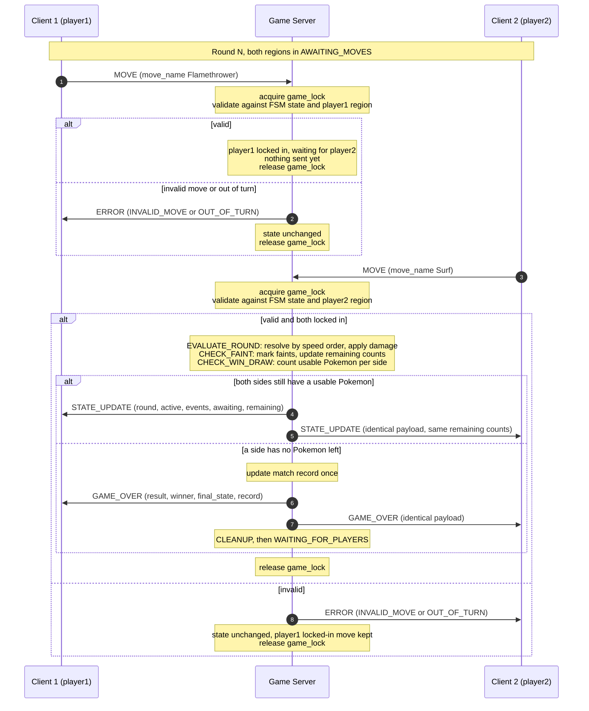

# Concurrency Design

**Course:** CS 457 – Computer Networks
**Project:** Gen 1 Pokémon Battle Simulator over TCP
**Sprint:** 2 – Concurrency Design
**Author:** Cameron Will

---

## 1. Overview

This document specifies how the server handles two clients at once without
corrupting game state. It builds directly on the Sprint 1 design:

- Message names, fields, and error codes come from
  [protocol_blueprint.md](protocol_blueprint.md).
- State names and transitions come from
  [fsm_specification.md](fsm_specification.md).
- Every message is still one line of newline-delimited JSON (NDJSON).

Summary of the design:

| Decision | Choice |
|---|---|
| Concurrency model | One worker thread per client connection (`threading`) |
| Synchronization | A single `threading.Lock` named `game_lock` protects all shared state |
| Network reads | `recv()` always happens **outside** `game_lock` |
| Broadcasts | Sent with `sendall()` **while holding** `game_lock` |
| Send failures | Recorded inside the lock, handled as a forfeit **after** the lock is released |
| Score | Remaining-Pokémon counts in every `STATE_UPDATE`, match record in every `GAME_OVER` |

---

## 2. Concurrency Model

### 2.1 Thread-per-client

| Thread | Count | Responsibility |
|---|---|---|
| **Main thread** | 1 | Creates the listening socket (`bind()` / `listen()`), then loops on `accept()`. For each new connection it spawns a worker thread and goes straight back to `accept()`. |
| **Worker thread** | 1 per connection | Runs `client_loop(conn, addr)`: the blocking receive loop from [protocol_blueprint.md §5.2](protocol_blueprint.md#52-correct-receive-loop). Parses NDJSON lines and hands each message to the game logic. |

```python
def main():
    srv = socket.socket(socket.AF_INET, socket.SOCK_STREAM)
    srv.bind((HOST, PORT))
    srv.listen()                                   # INIT -> WAITING_FOR_PLAYERS
    while True:
        conn, addr = srv.accept()                  # only blocking call on this thread
        threading.Thread(target=client_loop, args=(conn, addr), daemon=True).start()
```

- The main thread **never reads from or writes to a client socket** and never touches
  shared game state. As a result, the server keeps accepting new connections while a
  game is running.
- Worker threads are **daemon** threads, so stopping the server (Ctrl-C) does not hang
  waiting for clients that are blocked in `recv()`.

### 2.2 Why threading instead of `selectors`

The Sprint 1 protocol blueprint already specifies a **blocking, per-client receive
loop** (`client_loop`) with its own byte buffer and a `try` / `except` / `finally`
structure for the three termination paths. Thread-per-client maps onto that design
directly: each thread runs exactly that loop, unchanged.

| | Thread-per-client (chosen) | `selectors` event loop |
|---|---|---|
| Code structure | Straight-line blocking loop per client, as in the blueprint | One loop multiplexing all sockets, with per-socket buffers and callbacks |
| Shared state | Needs a lock (Section 5) | Single-threaded, so no locks are needed |
| Fit for 2 players | Thread overhead is negligible | Its scalability advantage is not needed |

The tradeoff is accepted deliberately: `selectors` would avoid locking entirely, but
it would require restructuring the receive path into a non-blocking event loop. With
only two players, one coarse lock (Section 5) is simple to reason about.

### 2.3 Capacity

- A game needs **exactly 2 players**.
- A **third** client that connects while a game is running is accepted and gets its
  own worker thread. When its `CONNECT` is processed, it is registered in the lobby
  and receives `LOBBY_WAIT`. It is **not** part of the running game. Any `MOVE` or
  `SWITCH` it sends gets `ERROR OUT_OF_TURN`.
- It stays in the lobby until `CLEANUP` returns the server to
  `WAITING_FOR_PLAYERS`.
- **Lobby rotation**
  (see [fsm_specification.md §4](fsm_specification.md#4-state-walkthrough)):
  - The lobby is a **FIFO queue ordered by arrival**.
  - On `CLEANUP`, the two players who just finished re-enter at the **back** of
    the queue, **winner first, then loser** (`player1` then `player2` on a
    `DRAW`).
  - The **first two players in the queue** start the next game.
  - **Example:** Red beats Blue while Green waits. The queue becomes
    `[Green, Red, Blue]`, so Green plays Red next and Blue waits.

---

## 3. Connection Lifecycle

Every connection follows the same path. The "Lock" column shows whether
`game_lock` is held during that step.

| Step | Thread | Lock | What happens |
|---|---|---|---|
| 1. `accept()` | Main | No | The main thread accepts the TCP connection and gets `(conn, addr)`. |
| 2. Spawn | Main | No | A daemon `threading.Thread` is started running `client_loop(conn, addr)`. The main thread returns to `accept()`. |
| 3. `CONNECT` received | Worker | No | The worker blocks in `recv()`, buffers bytes, and extracts the first complete NDJSON line. Parsing happens outside the lock. |
| 4. Register in lobby | Worker | **Yes** | Acquire `game_lock`. Add the player (name → socket) to the back of the lobby queue. Roles are assigned in lobby queue order when a game starts: the first player in the queue becomes `player1`, the second becomes `player2`. |
| 5. `LOBBY_WAIT` or `GAME_START` | Worker | **Yes** | If this is the only player in the lobby, or a game is already running, send `LOBBY_WAIT` to this client. If this player makes two, the server moves to `GAME_START`: it assigns teams, sends each client its personalized `GAME_START`, broadcasts the round-1 `STATE_UPDATE`, and releases the lock. |
| 6. In-game servicing | Worker | Per message | Loop: `recv()` outside the lock → extract complete lines → for each message, acquire `game_lock`, validate, mutate, (possibly) resolve the round, send, release (Section 5.3). |
| 7. Teardown | Worker | No → **Yes** | The loop exits by one of the three paths below. All three reach the `finally` block, which calls `game.on_player_left(player)` (acquires the lock) and then `conn.close()`. |

**The three teardown paths** (identical to
[protocol_blueprint.md §5](protocol_blueprint.md#5-connection-termination)):

| Path | How the worker notices | Exit from `client_loop` |
|---|---|---|
| Graceful `DISCONNECT` | A parsed line with `"type": "DISCONNECT"` | `return` |
| TCP FIN | `recv()` returns `b""` | `break` |
| Abrupt RST / dead socket | `recv()` raises `ConnectionResetError` / `BrokenPipeError` / `ConnectionAbortedError` | `except` |

All three converge on the `finally` block, so **`on_player_left()` is the only place
that applies a forfeit, sends `GAME_OVER` to the survivor, and moves the server to
`CLEANUP`.** Under `game_lock`, `on_player_left()` does the following:

1. If the player is no longer registered, it does nothing. A second call for the same
   player is harmless (see Section 5.5).
2. If the player is in the lobby but **not** in the running game (for example a waiting
   third client), it removes them from the lobby.
3. If the player is in the running game (`GAME_START` through `CHECK_WIN_DRAW`), it
   updates the match record (Section 8), sends `GAME_OVER` with `result: "FORFEIT"`
   and `winner:` the survivor, and goes to `CLEANUP` → `WAITING_FOR_PLAYERS`.

---

## 4. Shared Resources

All of the following are read and written by **worker threads only**. The main thread
touches none of them. Every access, read or write, happens while holding `game_lock`.

| Resource | Contents | Read by | Written by | What goes wrong if unprotected |
|---|---|---|---|---|
| **Lobby / connected-client list** | FIFO queue ordered by arrival. Each entry holds `player_name` → socket, role. | Every worker (to address sends, look up the opponent, count players, pick the first two in the queue) | Worker handling `CONNECT` (add at the back), `CLEANUP` (re-enqueue the finished players, winner first), `on_player_left()` (remove) | Two simultaneous `CONNECT`s both see an empty lobby and both become `player1`, or neither starts the game. Concurrent enqueue and remove operations corrupt the queue order, so the wrong players start the next game or a waiting player is skipped. A broadcast iterates the list while another thread removes an entry, so a message goes to a closed socket or the list changes size during iteration. Two threads `sendall()` to the same socket at once and their bytes interleave, breaking NDJSON framing. |
| **FSM state** | Current server state (`WAITING_FOR_PLAYERS`, `GAME_START`, …, `CLEANUP`) | Every worker, to validate each message | Workers on `CONNECT`, round resolution, `GAME_OVER`, and `on_player_left()` | A message is validated against a stale state (for example a `MOVE` accepted after `CLEANUP`). Two threads both move the machine to `GAME_OVER` / `CLEANUP`. |
| **Teams** | Both players' Pokémon, HP, status, active index | Workers validating `MOVE` / `SWITCH`, building `STATE_UPDATE` / `GAME_OVER` | Round resolution (damage, status, `FNT`), valid `SWITCH`, `CLEANUP` (reset) | A `SWITCH` changes the active Pokémon halfway through damage calculation. A `STATE_UPDATE` reports HP from half-applied damage. `CLEANUP` clears teams while a round is resolving. |
| **Per-player readiness and pending moves** | Each player's region (`AWAITING_MOVES` / `AWAITING_SWITCH` / locked in) and their locked-in `move_name` | Workers validating actions and checking "both locked in" | Worker accepting `MOVE` / `SWITCH`, round resolution (reset each round), `CLEANUP` | Both threads see "both locked in" and resolve the round twice. A check-then-write race lets a double-sent `MOVE` overwrite the first one. One player's error path accidentally clears the opponent's locked-in move. |
| **Round counter** | Current `round` | Workers building `STATE_UPDATE` / `GAME_OVER` | Round resolution (`round++` in `CHECK_WIN_DRAW`), `GAME_START` (set to 1), `CLEANUP` | Incremented twice for one round, or the two clients receive `STATE_UPDATE`s with different round numbers. |
| **Remaining-Pokémon counts** | Non-fainted Pokémon per side (per-battle score) | `CHECK_WIN_DRAW`, workers building `STATE_UPDATE` | `GAME_START` (team size), `CHECK_FAINT` (recompute), `CLEANUP` | The win/draw decision uses a count that does not match the teams. The two clients are shown different scores. |
| **Match record** | `player_name` → `{wins, losses, draws}`, kept across rematches | Workers building `GAME_OVER` | The critical section that builds `GAME_OVER` (normal end or forfeit) | A lost update (two read-modify-writes overlap and one result disappears). The same game is counted twice when both players disconnect at nearly the same time. |

> `CLEANUP` resets the teams, readiness and pending moves, round counter, and
> remaining counts. It does **not** reset the match record, which lasts as long
> as the server process.

---

## 5. Locking Strategy

### 5.1 One coarse lock: `game_lock`

```python
game_lock = threading.Lock()
```

A single `threading.Lock` protects **every** resource in Section 4. One lock is the
right choice here because:

- **Only 2 players.** There is almost no contention, so finer-grained locks would
  not buy any measurable parallelism.
- **Short critical sections.** Validating a message, applying a move, and even
  resolving a full round are pure in-memory computations on a few small objects.
- **No lock-ordering deadlocks.** With one lock there is no ordering to get wrong. A
  design with separate lobby, team, and record locks would need a strict global
  acquisition order in every code path.
- **Atomic multi-resource updates.** Resolving a round touches teams, readiness,
  round, remaining counts, and possibly the FSM state and match record together. A
  single lock makes the whole update atomic for free.

### 5.2 `recv()` is always outside the lock

A worker **never blocks on the network while holding `game_lock`.** `recv()`, buffer
appends, line splitting, and `json.loads()` all run without the lock. A thread
acquires `game_lock` only **after** a complete NDJSON line has been parsed into a
message.

If a thread held the lock while waiting in `recv()`, the other player's thread
could not process anything until the first client happened to send data. That would
stall the game, or deadlock it if both sides were waiting on each other.

### 5.3 Critical section for one message

Every in-game message is handled in one critical section:

1. **Acquire** `game_lock`.
2. **Validate** the message against the current FSM state **and** the sender's own
   readiness region (Section 7).
3. **Mutate** state: lock in the `MOVE`, or apply the `SWITCH`.
4. **Resolve if ready:** if both players are now locked in, run
   `EVALUATE_ROUND` → `CHECK_FAINT` → `CHECK_WIN_DRAW` **inside the same critical
   section**.
5. **Build** the outgoing messages (`ERROR`, `STATE_UPDATE`, or `GAME_OVER`, or none).
6. **Send** them with `sendall()`.
7. **Release** the lock.

```python
def handle(self, player, msg):
    failed = []                                    # players whose socket died mid-send
    with game_lock:
        error = self.validate(player, msg)         # FSM state + this player's region
        if error:
            outgoing = [(player, error)]           # ERROR to the sender only
        else:
            self.apply(player, msg)                # lock in MOVE or apply SWITCH
            if self.both_locked_in():
                self.resolve_round()               # EVALUATE_ROUND -> CHECK_FAINT -> CHECK_WIN_DRAW
            outgoing = self.build_messages()       # STATE_UPDATE / GAME_OVER, or nothing
        for target, out in outgoing:
            if not send_line(target.conn, out):
                failed.append(target)
    for target in failed:                          # lock released: safe to re-acquire
        self.on_player_left(target)


def send_line(conn, obj) -> bool:
    try:
        conn.sendall((json.dumps(obj) + "\n").encode("utf-8"))
        return True
    except (BrokenPipeError, ConnectionResetError, ConnectionAbortedError):
        return False
```

### 5.4 Broadcasts are sent while holding the lock

Both copies of a broadcast (`STATE_UPDATE`, `GAME_OVER`) are sent with `sendall()`
**before** `game_lock` is released. This guarantees two things:

- **Same order on both clients.** No other thread can send anything between the two
  `sendall()` calls, so both clients receive every `STATE_UPDATE` in the same order.
- **No mutation between the two sends.** No other thread can change state between
  the copy sent to player1 and the copy sent to player2, so both copies describe the
  same state.

For the same reason, **every** write to a client socket happens under `game_lock`.
That includes `ERROR` replies, `LOBBY_WAIT`, and `MALFORMED_MESSAGE` errors produced
while parsing. Two threads therefore never interleave partial `sendall()` bytes on
the same socket, which would corrupt the NDJSON framing.

**Tradeoff:** if one client's TCP receive window is full, `sendall()` blocks and
holds the lock until the kernel accepts the bytes. The other player's next message
waits for that time. Messages are small (a few hundred bytes) and there are only two
players, so this brief delay is acceptable.

### 5.5 Send failures are handled after the lock is released

A `sendall()` inside the critical section can raise `BrokenPipeError`,
`ConnectionResetError`, or `ConnectionAbortedError` if that client has already gone.
The handler must **not** call `on_player_left()` from inside the locked section:

- `on_player_left()` itself acquires `game_lock`.
- `threading.Lock` is **not reentrant**. A thread that tries to acquire a lock it
  already holds blocks forever, so the server would deadlock.

Instead, `send_line()` catches the exception and returns `False`. The handler
**records the failed player** and keeps going. Right **after** the `with game_lock:`
block exits, it calls `on_player_left()` for each recorded player. That call
re-acquires the lock, checks the **current** state, and applies the forfeit.

The failed player's own worker thread will also reach its `finally` block later,
when its `recv()` returns `b""` or raises. Its `on_player_left()` call then finds the
player already removed and does nothing. So a player is forfeited **exactly once**,
however many threads notice the failure.

### 5.6 `with game_lock:` everywhere

The lock is only ever taken with `with game_lock:`, never with bare
`acquire()` / `release()`. If an exception is raised inside the critical section
(for example a bug in damage calculation), the `with` block still releases the lock.
Otherwise the other player's thread would hang forever.

---

## 6. Race Conditions

Each scenario below is a real interleaving of the two worker threads. `game_lock`
turns each one into a safe, serial sequence.

| # | Scenario | Without the lock | With `game_lock` |
|---|---|---|---|
| 1 | **Both final `MOVE`s arrive at the same moment.** player1 and player2 are both in `AWAITING_MOVES` and send their `MOVE`s at the same time. | Thread A locks in player1, thread B locks in player2, then **both** check "both locked in?", both see `true`, and both resolve the round. Damage is applied twice and `round` is incremented twice. | The lock-in and the "both locked in?" check are one atomic step. Whichever thread gets the lock first sees only its own player locked in and releases without resolving. The second thread sees both locked in and resolves. **Exactly one thread resolves the round.** |
| 2 | **A player double-sends `MOVE`.** A client sends two `MOVE` lines back to back. | The "already locked in?" check and the write are separate steps, so the second `MOVE` could pass the check and overwrite the first. | The check and the write happen together under the lock. The second `MOVE` finds that player's region already locked in and gets `ERROR OUT_OF_TURN`. **The first move stands.** If the opponent's thread resolved the round between the two lines, the second `MOVE` is checked against the new round's state, never against a half-updated one. |
| 3 | **One player disconnects while the other's `MOVE` is resolving.** player2's thread is inside `EVALUATE_ROUND` when player1's socket closes. | player1's `on_player_left()` runs `CLEANUP` and clears the teams in the middle of damage calculation, which crashes the resolver or broadcasts garbage. | player1's `on_player_left()` blocks on `game_lock` until player2's critical section finishes, including its broadcast. It then sees the **current** state: if the game is still running it forfeits to player2, and if the round already ended the game it finds the server back in `WAITING_FOR_PLAYERS` and just removes player1 from the lobby. |
| 4 | **Both players disconnect at nearly the same time.** | Both `on_player_left()` calls see an in-game state, both send `GAME_OVER`, both update the match record, and both run `CLEANUP`. | The first `on_player_left()` to get the lock sees an in-game state, applies the forfeit, and moves to `CLEANUP` → `WAITING_FOR_PLAYERS`. Its `GAME_OVER` send to the other player may fail, and that failure is deferred as in Section 5.5. The second call sees `WAITING_FOR_PLAYERS` and only removes that player from the lobby. **`GAME_OVER`, the record update, and `CLEANUP` happen exactly once.** |
| 5 | **Two clients `CONNECT` at once.** | Both threads read "lobby is empty", both assign themselves `player1`, and both get `LOBBY_WAIT`, so the game never starts. | Registration and role assignment happen under the lock. The first `CONNECT` processed becomes `player1` and gets `LOBBY_WAIT`. The second sees one player waiting, becomes `player2`, and triggers `GAME_START`. **Both cannot become `player1`.** Roles follow lobby queue order ([protocol_blueprint.md §3.4](protocol_blueprint.md#34-player-roles)). For the first game, that is the order in which `CONNECT`s are processed under `game_lock`. |

---

## 7. Turn Enforcement

Every `MOVE` and `SWITCH` is validated **under `game_lock`, before any state is
touched**, against:

1. **The FSM state.** A game must be running, and the sender must be one of its two
   players. Otherwise the server sends `ERROR OUT_OF_TURN`.
2. **The sender's own readiness region**, never the opponent's:
   - `MOVE` is accepted only in that player's `AWAITING_MOVES` and only if the player has
     not locked in this round. `move_name` must be in the active Pokémon's moveset.
   - `SWITCH` is accepted only in that player's `AWAITING_SWITCH`. `switch_to` must be a
     non-fainted species on the sender's team.

A rejected message produces `ERROR` **to that client only**:

- No state changes.
- No broadcast.
- The opponent's locked-in move, if any, is preserved.

Because validation and mutation happen in the same critical section (Section 5.3),
no other thread can change the sender's region between the check and the write.

The full list of rejection cases and their error codes is in the edge-case table in
[fsm_specification.md §3](fsm_specification.md#3-edge-case-transitions) and is not
repeated here.

---

## 8. Score and Match Record Synchronization

The server is the single source of truth for both scores. Clients only display what
they receive.

### 8.1 Per-battle score: remaining Pokémon

| Aspect | Design |
|---|---|
| Definition | Count of non-fainted Pokémon on each side. |
| Storage | Server-side, `{"player1": int, "player2": int}`, protected by `game_lock`. |
| Initialized | In `GAME_START`, to each team's size. |
| Recomputed | In `CHECK_FAINT`, after fainted actives are marked `FNT`. `CHECK_WIN_DRAW` then uses these counts for its `WIN` / `DRAW` decision. |
| Reset | In `CLEANUP`. |
| Sent | In **every** `STATE_UPDATE` as the `remaining` field (round 1, after each resolved round, and after each accepted `SWITCH`). Both clients get the identical payload. |

### 8.2 Match record: wins, losses, draws

| Aspect | Design |
|---|---|
| Structure | `dict` keyed by `player_name` → `{"wins": int, "losses": int, "draws": int}`. |
| Updated | **Exactly once per game**, inside the critical section that builds `GAME_OVER`: `WIN` (winner +1 win, loser +1 loss), `DRAW` (both +1 draw), `FORFEIT` (survivor +1 win, leaver +1 loss). |
| Lifetime | Kept across rematches. **Not** cleared by `CLEANUP`. Lives in memory only, for as long as the server process runs. |
| Sent | In **every** `GAME_OVER` as the `record` field, containing the entries for both players in that game. |

**Limitations:**

- **Keyed by display name.** Two different clients using the same `player_name` share one
  record entry. A player who reconnects under a new name starts a new entry.
- **In memory only.** Restarting the server erases all records. Nothing is written to disk.

The schema changes for `STATE_UPDATE.remaining` and `GAME_OVER.record` are recorded
in [protocol_blueprint.md](protocol_blueprint.md) (see its Changelog).

---

## 9. Sequence Diagram: One Round Under `game_lock`



**Step-by-step** (numbers match the diagram's message numbers):

1. **Client 1 → `MOVE`.** player1's worker thread parses the line outside the lock,
   then acquires `game_lock` and validates the move against the FSM state and
   player1's region.
   - **Valid:** player1 is locked in. Player2 has not acted, so the round cannot
     resolve. The server sends **nothing**, because the opponent must not see a
     locked-in move before the round resolves. It then releases the lock.
2. **Invalid (else branch): `ERROR` to Client 1 only.** The move is not in the
   moveset (`INVALID_MOVE`) or player1 is not in `AWAITING_MOVES` (`OUT_OF_TURN`).
   No state changes and Client 2 receives nothing. The lock is released and Client 1
   re-prompts.
3. **Client 2 → `MOVE`.** player2's worker thread parses outside the lock, acquires
   `game_lock`, and validates against player2's region. If valid, it locks in
   player2 and finds **both** players locked in, so it runs `EVALUATE_ROUND`,
   `CHECK_FAINT` (which updates the remaining counts), and `CHECK_WIN_DRAW` in the
   same critical section.
4. **Game continues: `STATE_UPDATE` to Client 1.** Sent with `sendall()` while
   still holding the lock. It includes the incremented `round`, both actives, the
   round's `events`, the next `awaiting` values, and `remaining`.
5. **`STATE_UPDATE` to Client 2.** The identical payload, sent before the lock is
   released, so no other thread can change state or send anything between steps 4
   and 5. The lock is then released and both clients act on `awaiting`.
6. **Game decided: `GAME_OVER` to Client 1.** If `CHECK_WIN_DRAW` finds a side with
   no usable Pokémon, the server updates the match record exactly once, then sends
   `GAME_OVER` (`WIN` or `DRAW`) with `final_state` and the updated `record`. In this
   case it sends `GAME_OVER` **instead of** `STATE_UPDATE`, as in the FSM's
   `CHECK_WIN_DRAW → GAME_OVER` transition.
7. **`GAME_OVER` to Client 2.** Identical payload, still under the lock. The server
   then runs `CLEANUP` (resets teams, readiness, round, and remaining counts, but
   keeps the record), returns to `WAITING_FOR_PLAYERS`, and releases the lock.
8. **Invalid (else branch): `ERROR` to Client 2 only.** player2's state is unchanged
   and **player1's locked-in move is kept**. The round stays unresolved until
   player2 sends a valid `MOVE`.

If any `sendall()` in steps 2, 4–8 fails, the failed player is recorded and handled
by `on_player_left()` after the lock is released (Section 5.5).
