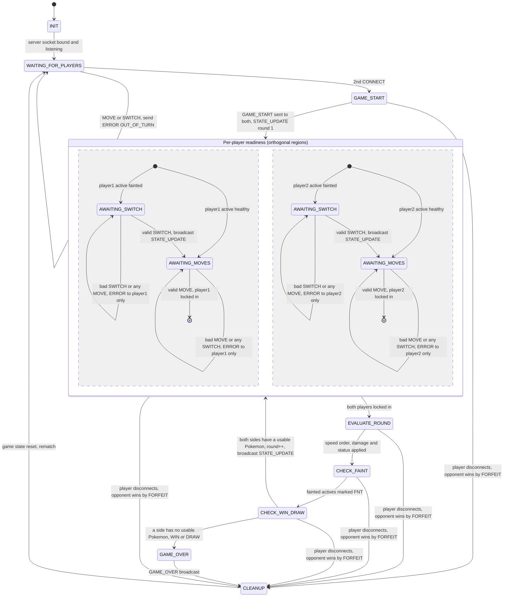

# FSM Specification

**Course:** CS 457 – Computer Networks
**Project:** Gen 1 Pokémon Battle Simulator over TCP
**Sprint:** 1 – Design
**Author:** Cameron Will

---

## 1. Overview

This document specifies the **server's** finite state machine. The server is the
single source of truth. Clients only render what `STATE_UPDATE` tells them and send
the action named in its `awaiting` field. Message names and schemas are defined in
[protocol_blueprint.md](protocol_blueprint.md).

**Key design rule: per-player readiness is tracked independently.**
`AWAITING_MOVES` and `AWAITING_SWITCH` are **not** a single shared "waiting" state.
They are modeled as two **orthogonal (concurrent) regions**, one per player, inside
the per-player readiness container. Each player moves through their own region at
their own pace. For example, player 2 can be in `AWAITING_SWITCH` after a faint
while player 1 is already in `AWAITING_MOVES` and has locked in their next move.
The round resolves only when **both** regions have finished.

"For rubric alignment: READINESS (containing the per-player AWAITING_MOVES/AWAITING_SWITCH regions) corresponds to the rubric's PLAYER_TURN state, and EVALUATE_ROUND corresponds to EVALUATE_MOVE."

---

## 2. State Diagram

**Reading the diagram:**

- The two halves of the readiness container, separated by the dashed line, are
  the **player 1 region** and the **player 2 region**. They run **concurrently and
  independently**.
- On each entry into the container, each region picks its own start state. It starts in
  `AWAITING_SWITCH` if **that** player's active Pokémon fainted and in `AWAITING_MOVES`
  otherwise. Either, both, or neither player may start in `AWAITING_SWITCH`.
- A region's final marker means "this player has locked in a valid `MOVE` for the
  round". The container is exited to `EVALUATE_ROUND` only when **both** regions
  have reached it.
- "Player disconnects" covers all three termination paths in
  [protocol_blueprint.md §5](protocol_blueprint.md#5-connection-termination):
  a `DISCONNECT` message, a 0-byte `recv()` (FIN), or `ConnectionResetError` /
  `BrokenPipeError` / `ConnectionAbortedError` (RST or dead socket).

---

## 3. Edge-Case Transitions

| Trigger | From | Action | Result state |
|---|---|---|---|
| Invalid `MOVE` (not in the active Pokémon's moveset) | player's `AWAITING_MOVES` | `ERROR INVALID_MOVE` to **that client only** | unchanged; only that client re-prompts |
| `MOVE` while a switch is required | player's `AWAITING_SWITCH` | `ERROR OUT_OF_TURN` to that client only | unchanged |
| `SWITCH` when nothing fainted | player's `AWAITING_MOVES` | `ERROR OUT_OF_TURN` to that client only | unchanged |
| Second `MOVE` after locking in | player's region already final | `ERROR OUT_OF_TURN` to that client only | unchanged; the first move stands |
| `SWITCH` to a fainted Pokémon | player's `AWAITING_SWITCH` | `ERROR FAINTED_POKEMON_SELECTED` to that client only | unchanged |
| `SWITCH` to a species not on the team | player's `AWAITING_SWITCH` | `ERROR INVALID_MOVE` to that client only | unchanged |
| Unparseable line or bad keys | any state | `ERROR MALFORMED_MESSAGE` to that client only | unchanged |
| `MOVE` / `SWITCH` before a game exists | `WAITING_FOR_PLAYERS` | `ERROR OUT_OF_TURN` | unchanged |
| Disconnect (any of the three kinds) | any state from `GAME_START` through `CHECK_WIN_DRAW` | `GAME_OVER` (`result: "FORFEIT"`, `winner:` the opponent) to the survivor | `CLEANUP` |
| Disconnect | `WAITING_FOR_PLAYERS` | remove the player from the lobby | unchanged |
| `GAME_OVER` sent | `GAME_OVER` | none | `CLEANUP` → `WAITING_FOR_PLAYERS` |

An error never moves the machine or touches the other player's region. For example,
if player 1 sends a bad `SWITCH`, player 2's already-locked-in move is kept.

---

## 4. State Walkthrough

### `INIT`
- **Entry:** the server process starts.
- **Work:** load the curated species and move data, then create, bind, and listen on the server socket.
- **Exit:** → `WAITING_FOR_PLAYERS` once the socket is listening.

### `WAITING_FOR_PLAYERS`
- **Entry:** from `INIT`, or from `CLEANUP` after a game ends.
- **Work:** accept connections and read `CONNECT`. The first player gets `LOBBY_WAIT`.
  When the server re-enters this state from `CLEANUP`, still-connected players are
  kept and each is sent `LOBBY_WAIT`. A lobby player who disconnects is dropped.
  `MOVE`/`SWITCH` here return `ERROR OUT_OF_TURN`.
- **Exit:** → `GAME_START` when two players are in the lobby.

### `GAME_START`
- **Entry:** the second player joins.
- **Work:** assign `player1`/`player2` roles and randomly assign each player a fixed
  team. Send each client a personalized `GAME_START` with its role, its own team, and the
  opponent's full team. Set `round = 1`, then broadcast `STATE_UPDATE` with
  `awaiting: {"player1": "MOVE", "player2": "MOVE"}`.
- **Exit:** → the per-player readiness container, with both regions starting in `AWAITING_MOVES`.
  A disconnect → `CLEANUP` (forfeit).

### `AWAITING_MOVES` (per player)
- **Entry:** at the start of each round for a player whose active Pokémon is healthy,
  or right after that player's valid `SWITCH`.
- **Work:** wait for this player's `MOVE`. Validate `move_name` against the active
  Pokémon's moveset. Store the valid move as this player's pending action. Its
  contents are not shown to the opponent yet.
- **Exit:** a valid `MOVE` → this region is final (locked in). An invalid or out-of-turn
  action → `ERROR` to this player and stay in this state.

### `AWAITING_SWITCH` (per player)
- **Entry:** at the start of a round for a player whose active Pokémon fainted in the
  previous round and who still has at least one usable Pokémon.
- **Work:** wait for this player's `SWITCH`. Validate that `switch_to` is on the team
  and not fainted. On success, set the new active Pokémon and broadcast
  `STATE_UPDATE` with `awaiting[player] = "MOVE"`. The opponent sees the new active
  Pokémon before the round resolves.
- **Exit:** a valid `SWITCH` → this player's `AWAITING_MOVES`. An invalid action → `ERROR`,
  stay. Meanwhile the **other** player's region keeps going. They may already be in
  `AWAITING_MOVES`, or locked in.

### `EVALUATE_ROUND`
- **Entry:** both regions are final, so both moves are locked in.
- **Work:** resolve the round with Gen 1 rules. Order actions by speed, check accuracy,
  and apply damage and status effects. Append each outcome to the round's `events`
  log. If the first attacker's move knocks out the target, the fainted Pokémon's
  move is skipped.
- **Exit:** → `CHECK_FAINT`. This state and the two after it run synchronously without
  reading from sockets, so a disconnect that happens here is detected at the next
  read or broadcast. It is still routed to `CLEANUP` (forfeit).

### `CHECK_FAINT`
- **Entry:** round resolution is finished.
- **Work:** mark any active Pokémon at 0 HP as `FNT` and add "X fainted!" events.
  Record, **per player**, whether that player will need to switch next round.
- **Exit:** → `CHECK_WIN_DRAW`.

### `CHECK_WIN_DRAW`
- **Entry:** faint processing is finished.
- **Work:** count each side's non-fainted Pokémon.
  - Both sides at zero → `DRAW`.
  - One side at zero → `WIN` for the other side.
  - Otherwise the game continues.

  This check runs **before** any switch prompt, because a player whose last
  Pokémon fainted has nothing to switch to.
- **Exit:**
  - Game continues → increment `round` and broadcast `STATE_UPDATE`, with `awaiting` set per player to `"SWITCH"` or `"MOVE"`. Then re-enter the readiness container, where each region picks its own start state.
  - Game decided → `GAME_OVER`.

### `GAME_OVER`
- **Entry:** `CHECK_WIN_DRAW` found a `WIN` or `DRAW`.
- **Work:** broadcast `GAME_OVER` with `result`, `winner` (`null` for a draw), and `final_state`.
- **Exit:** → `CLEANUP`.

### `CLEANUP`
- **Entry:** from `GAME_OVER`, or from any in-game state on a disconnect.
- **Work:**
  - **On a disconnect:** send the surviving player `GAME_OVER` with `result: "FORFEIT"` and `winner:` the survivor, then close the departed player's socket.
  - **Always:** clear the teams, pending actions, round counter, and per-player region state.
- **Exit:** → `WAITING_FOR_PLAYERS`, keeping any still-connected clients in the lobby for a rematch.

---

## 5. Example Trace: Asymmetric Readiness

| Step | Event | player1 region | player2 region |
|---|---|---|---|
| 1 | Round 3 resolves, player2's Alakazam faints (player2 still has Gengar) | — | — |
| 2 | `CHECK_WIN_DRAW`: continue, round → 4, `STATE_UPDATE awaiting {p1: MOVE, p2: SWITCH}` | `AWAITING_MOVES` | `AWAITING_SWITCH` |
| 3 | player1 sends `MOVE Flamethrower` | locked in | `AWAITING_SWITCH` |
| 4 | player2 sends `SWITCH Alakazam` | locked in | `AWAITING_SWITCH` (`ERROR FAINTED_POKEMON_SELECTED`) |
| 5 | player2 sends `SWITCH Gengar`, `STATE_UPDATE awaiting {p1: null, p2: MOVE}` | locked in | `AWAITING_MOVES` |
| 6 | player2 sends `MOVE Hypnosis` | locked in | locked in |
| 7 | Both regions final | → `EVALUATE_ROUND` (round 4) | |
