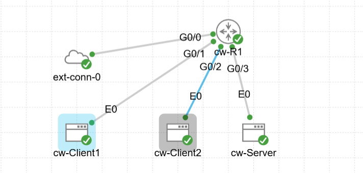
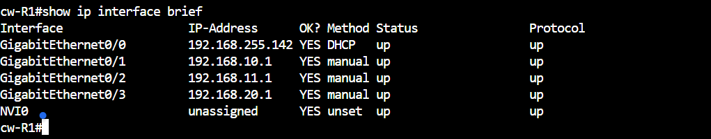
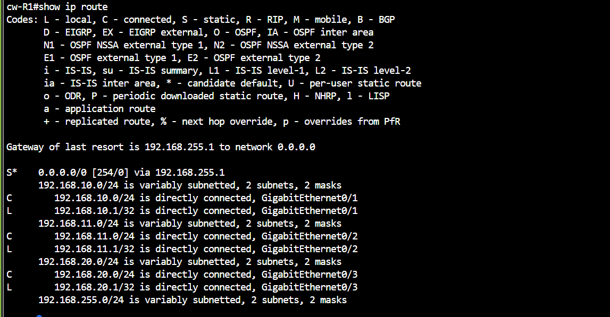
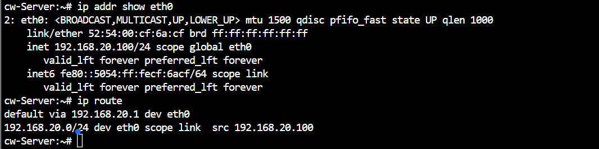
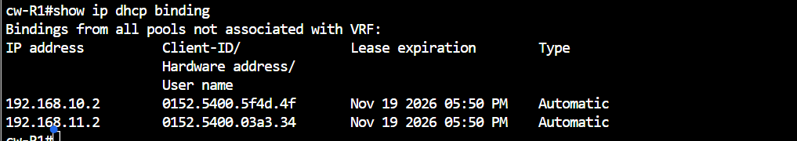
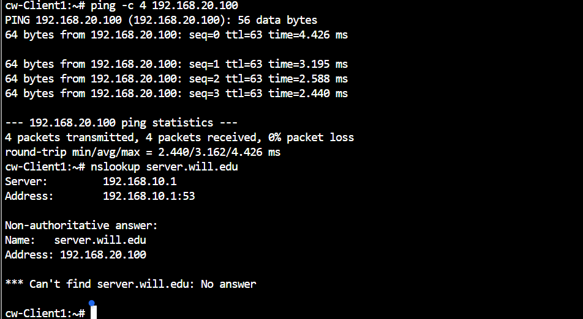
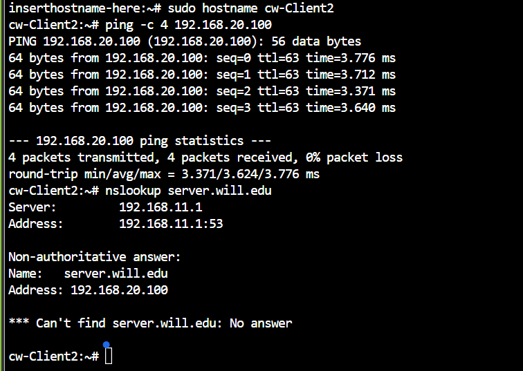
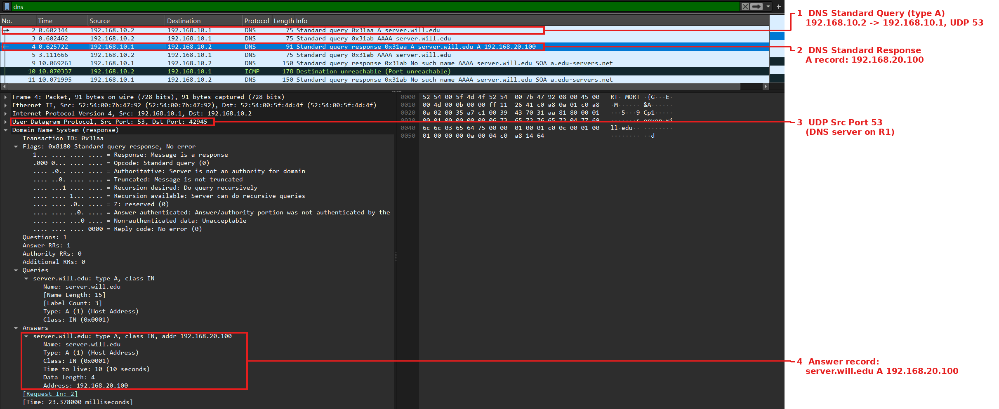

# Sprint 4 Network Verification Report

**Course:** CS 457 – Computer Networks
**Project:** Gen 1 Pokémon Battle Simulator over TCP
**Sprint:** 4 – CML 1-Router Network Topology & Infrastructure Deployment
**Author:** Cameron Will
**Target Server Domain:** `server.will.edu`

---

## 1. Deliverables

| Deliverable | File |
|---|---|
| CML topology export | [`sprint_4_topology.yaml`](sprint_4_topology.yaml) |
| Wireshark DNS capture | [`sprint_4_dns_lookup.pcap`](sprint_4_dns_lookup.pcap) |
| Network verification report | this file |
| Screenshots | [`sprint_4_images/`](sprint_4_images/) |

---

## 2. Topology

A single Cisco IOSv router (`cw-R1`) connects three subnets on three routed
interfaces. An External Connector (NAT mode) on Gi0/0 gives the lab outbound
access for package installs.



| Node | Interface | Subnet | Address | How assigned |
|---|---|---|---|---|
| `cw-R1` | Gi0/0 | 192.168.255.0/24 (External Connector) | 192.168.255.142 | DHCP from the External Connector |
| `cw-R1` | Gi0/1 | Subnet A, 192.168.10.0/24 | 192.168.10.1 | Static (gateway for Client 1) |
| `cw-R1` | Gi0/2 | Subnet B, 192.168.11.0/24 | 192.168.11.1 | Static (gateway for Client 2) |
| `cw-R1` | Gi0/3 | Subnet C, 192.168.20.0/24 | 192.168.20.1 | Static (gateway for Game Server) |
| `cw-Client1` | eth0 | Subnet A | 192.168.10.2 | DHCP (`CLIENT1_POOL`) |
| `cw-Client2` | eth0 | Subnet B | 192.168.11.2 | DHCP (`CLIENT2_POOL`) |
| `cw-Server` | eth0 | Subnet C | 192.168.20.100 | Static |

All three LAN subnets are directly connected to R1, so no static routes are
needed between them.

---

## 3. Router R1 Configuration

```
hostname cw-R1
ip routing
!
interface GigabitEthernet0/0
 ip address dhcp
 ip nat outside
 no shutdown
interface GigabitEthernet0/1
 ip address 192.168.10.1 255.255.255.0
 ip nat inside
 no shutdown
interface GigabitEthernet0/2
 ip address 192.168.11.1 255.255.255.0
 ip nat inside
 no shutdown
interface GigabitEthernet0/3
 ip address 192.168.20.1 255.255.255.0
 ip nat inside
 no shutdown
!
ip dhcp excluded-address 192.168.10.1
ip dhcp excluded-address 192.168.11.1
ip dhcp pool CLIENT1_POOL
 network 192.168.10.0 255.255.255.0
 default-router 192.168.10.1
 dns-server 192.168.10.1
ip dhcp pool CLIENT2_POOL
 network 192.168.11.0 255.255.255.0
 default-router 192.168.11.1
 dns-server 192.168.11.1
!
ip domain lookup
ip dns server
ip host server.will.edu 192.168.20.100
!
access-list 1 permit 192.168.10.0 0.0.0.255
access-list 1 permit 192.168.11.0 0.0.0.255
access-list 1 permit 192.168.20.0 0.0.0.255
ip nat inside source list 1 interface GigabitEthernet0/0 overload
ip name-server 8.8.8.8
!
end
write memory
```

---

## 4. Single-Router Multi-Subnet Addressing

### 4.1 `show ip interface brief`

All four router interfaces are **up/up** with the correct addresses.



### 4.2 `show ip route`

R1 has a **Connected (C)** route for each of the three subnets: 192.168.10.0/24
on Gi0/1, 192.168.11.0/24 on Gi0/2, and 192.168.20.0/24 on Gi0/3. It also has a
default route via the External Connector (192.168.255.1) for outbound NAT
traffic.



### 4.3 Game Server static IP and default gateway

`cw-Server` was configured by hand:

```
sudo ip addr add 192.168.20.100/24 dev eth0
sudo ip link set eth0 up
sudo ip route add default via 192.168.20.1
echo "nameserver 192.168.20.1" | sudo tee /etc/resolv.conf
```

`ip addr show eth0` shows `inet 192.168.20.100/24`, and `ip route` shows
`default via 192.168.20.1`. Without that default route, the server could
receive a client's packets but couldn't send replies back to 192.168.10.x or
192.168.11.x.



---

## 5. DHCP Multi-Subnet Allocation

R1 runs two separate pools:

- **`CLIENT1_POOL`** (192.168.10.0/24): gateway 192.168.10.1, DNS 192.168.10.1.
- **`CLIENT2_POOL`** (192.168.11.0/24): gateway 192.168.11.1, DNS 192.168.11.1.

Each gateway address is excluded with `ip dhcp excluded-address`, so R1 never
hands out its own interface IP. R1 picks the pool by the subnet of the
interface the DHCPDISCOVER arrives on.

On each client, the lease was requested with:

```
sudo ip link set eth0 up
sudo udhcpc -i eth0
```

`show ip dhcp binding` confirms an active automatic lease for each client on
its own subnet: **192.168.10.2** (Client 1) and **192.168.11.2** (Client 2).



---

## 6. Authoritative DNS and Cross-Subnet Connectivity

R1 answers DNS queries itself (`ip dns server`) and holds a static A record,
`ip host server.will.edu 192.168.20.100`. Each client got R1's gateway address
as its DNS server through DHCP Option 6.

### 6.1 Client 1

- **`ping -c 4 192.168.20.100`:** 4 transmitted, 4 received, **0% packet loss**.
  The TTL of 63 shows each reply crossed one router hop.
- **`nslookup server.will.edu`:** answered by **192.168.10.1:53** with
  `Address: 192.168.20.100`.



### 6.2 Client 2

- **`ping -c 4 192.168.20.100`:** **0% packet loss**, TTL 63.
- **`nslookup server.will.edu`:** answered by **192.168.11.1:53** with
  `Address: 192.168.20.100`.



### 6.3 Note on `*** Can't find server.will.edu: No answer`

Alpine's BusyBox `nslookup` sends both an **A** (IPv4) query and an **AAAA**
(IPv6) query. R1's `ip host` entry is IPv4 only, so the A query returns
192.168.20.100 and the AAAA query returns no answer. The line at the end of
each lookup is the empty AAAA result, not a failure. This is the behavior
described in the Sprint 4 instructions (§2.4). It is also why Python's
`socket.gethostbyname()` is used in `client.py`, since it only asks for IPv4.

---

## 7. Wireshark DNS Capture

**File:** [`sprint_4_dns_lookup.pcap`](sprint_4_dns_lookup.pcap)
**Capture point:** the `cw-Client1` ↔ `cw-R1` link (Gi0/1, Subnet A).
**Trigger:** `nslookup server.will.edu` on `cw-Client1`.
**Display filter:** `dns`



| # | Packet | What it shows |
|---|---|---|
| 1 | Frame 2 | **DNS Standard Query** (type A) for `server.will.edu`, from Client 1 (192.168.10.2) to R1 (192.168.10.1) on **UDP port 53**. |
| 2 | Frame 4 | **DNS Standard Response** (transaction 0x31aa, the same as the query), from R1 back to Client 1. Reply code: No error. |
| 3 | Frame 4, UDP header | **Source port 53**, which confirms R1's DNS server sent the answer. |
| 4 | Frame 4, Answers | `server.will.edu: type A, class IN, addr` **192.168.20.100**, the Game Server's static IP. |

The other packets in the capture are expected:

- **Frames 3, 5, 9 and 11:** the AAAA (IPv6) query and its "No such name"
  response, explained in §6.3. R1 has no AAAA record, so it forwards the
  question to its upstream resolver (`ip name-server 8.8.8.8`), and the real
  `.edu` servers reply that the name doesn't exist.
- **Frame 10 (ICMP Port unreachable):** the AAAA response arrived after
  `nslookup` had already received its answer and closed its UDP socket, so the
  client's kernel bounced it. This is normal and has no effect on the lookup.

---

## 8. Acceptance Checklist

| Requirement | Evidence |
|---|---|
| Single router R1 connects Subnets A, B and C | §2, §4.1, §4.2 |
| All router interfaces up/up with connected routes | §4.1, §4.2 |
| Game Server static 192.168.20.100/24 with default gateway 192.168.20.1 | §4.3 |
| Separate DHCP pools with gateway exclusions, default router and DNS options | §3, §5 |
| Active DHCP leases for both clients | §5 |
| R1 authoritative DNS (`ip dns server` and `ip host server.will.edu`) | §3, §6 |
| `nslookup server.will.edu` returns 192.168.20.100 on both clients | §6.1, §6.2 |
| Zero-loss ping from both clients to the Game Server | §6.1, §6.2 |
| DNS query and response captured and annotated | §7 |
| Custom node names with initials (`cw-`) | §2 |
